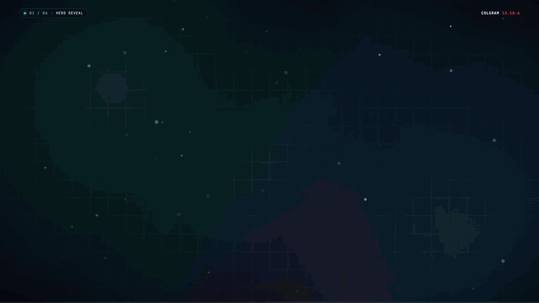

<div align="center">
  
  <h1>Colgram 12.10.6</h1>
  <p><strong>Форк Telegram для Android со встроенным двухуровневым обходом блокировок (L1 WSS/DPI + L2 L3-Relay), локальной языковой моделью Koliti AI (Qwen3.5-2B + Vision + Голос), контент-адресуемым хранилищем без лимитов кэша и жёсткой изоляцией приватности.</strong></p>
  <p>
    <a href="https://github.com/Kleisym/Colgram/releases/latest"></a>
    <a href="https://github.com/Kleisym/Colgram/raw/main/docs/media/colgram-release.mp4"></a>
    <a href="docs/BUILD-AND-TEST.md"></a>
  </p>
</div>

---

## Видео-обзор релиза Colgram 12.10.6 (1080p60)

<video src="https://github.com/Kleisym/Colgram/raw/main/docs/media/colgram-release.mp4" controls poster="docs/media/colgram-release-poster.png" width="100%"></video>

[](https://github.com/Kleisym/Colgram/raw/main/docs/media/colgram-release.mp4)

> [!TIP]
> Нажмите на превью выше или откройте [**прямую ссылку на 1080p60 MP4**](https://github.com/Kleisym/Colgram/raw/main/docs/media/colgram-release.mp4) (также доступно в [ассетах GitHub Release](https://github.com/Kleisym/Colgram/releases/latest)), чтобы посмотреть 36-секундный разбор архитектуры релиза `12.10.6`.

---

## Что внутри сборки 12.10.6

Colgram построен поверх чистого апстрима `DrKLO/Telegram` (`12.10.6`, коммит `f2908b14133bbffbf7ab04f641ecb5bfaf533242`). Вся собственная логика вынесена в изолированное ядро `colgram-core/`, нативные модули (`libcolgram_llama.so`, `libcolgramdesync.so`, `libcolgrammasque.so`, `libbox.so`) и шаблоны экранов `scripts/templates/`.

### 1. Двухуровневый обход блокировок на любом интернете (L1 + L2 Zero-Click Bypass)

Клиент поднимает соединение с дата-центрами Telegram (`DC1–DC5`) без внешних VPN-приложений и ручного перебора прокси — как на домашнем Wi-Fi с фильтрацией ТСПУ по SNI, так и на мобильных сетях 4G/LTE, где оператор глушит подсети Telegram (`149.154.160.0/20`, `91.108.4.0/22`) на уровне маршрутизации вышки.

- **Уровень 1 — Локальный WSS-мост и десинхронизация DPI (Wi-Fi и сети с L7 ТСПУ)**:
  - Локальный `TLS 1.3 WSS`-мост на `127.0.0.1:9876` (`ColgramTelegramWsBridge`) заворачивает трафик MTProto в WebSocket к `kws1..5.web.telegram.org`.
  - В открытом `ClientHello` передаётся SNI из российского белого списка (`max.ru`, `vk.com`, `gosuslugi.ru`, `ya.ru`, `ozon.ru`, `sberbank.ru`), при этом клиент строго проверяет подлинность сертификата сервера по официальным SAN Telegram (`*.web.telegram.org`, `*.telegram.org`). Подменить сертификат по пути невозможно.
  - Нативный сплиттер `MODE_MULTI_SPLIT_SNI` (`ColgramDpiBypass` / `libcolgramdesync.so`) режет `ClientHello` прямо посередине поля SNI с включённым `TCP_NODELAY`, сбивая сборку пакета на ТСПУ.
  - Параллельный шифрованный DNS-резолвер: `DoT :853` + 3-поточный `DoH` (`1.1.1.1`, `8.8.8.8`, `77.88.8.8`) по bootstrap-IP без участия провайдерского DNS.
  - **Замер на домашнем Wi-Fi с ТСПУ**: выход на `ConnectionStateConnected` и получение `7TL_pong` за **~354 мс**.
- **Уровень 2 — Автоматический каскад L3-релеев (Мобильные сети 4G/LTE с блоком по IP)**:
  - Если сотовая вышка отбрасывает пакеты к IP-адресам Telegram и `*.web.telegram.org` на 3-м уровне (L3 Blackhole), детектор фиксирует тайм-аут прямых сокетов за **~5 секунд** и автоматически переключает мост на каскад проверенных L3-релеев.
  - Рукопожатия `SOCKS5 CONNECT` и `HTTP CONNECT` к релею отправляются 2-байтовыми TCP-сегментами (`TCP_NODELAY` + пауза `16 мс`), после чего внутри туннеля дополнительно режется вложенный `TLS ClientHello` / `WSS`.
  - **Замер на живой сети MegaFon/Yota 4G LTE (`TECNO_LI6`)**: автоматический обход блокировки вышки с холодного старта за **~10 секунд**, стабильный пинг до DC2 **~440 мс**.
- **Обход для всего телефона и встроенные туннели**:
  - **Встроенный `ByeDPI`**: локальный прокси для браузеров, YouTube, Discord и звонков без стороннего VPN.
  - **Cloudflare WARP (`:colgram_masque`)**: нативный клиент MASQUE (`HTTP/2` и WireGuard в `libcolgrammasque.so`) в отдельном системном процессе с проверкой SPKI-ключа регистрации.
  - **Sing-box (`colgram-singbox`)**: поддержка подписок и узлов `VLESS`, `VMess`, `Trojan`, `Reality` и `Hysteria2`.

---

### 2. Koliti AI — Офлайн-ядро `Qwen3.5-2B`, Vision и Голос внутри чатов

Ассистент Koliti работает локально на процессоре телефона — без передачи переписки, голосовых и фотографий во внешние облака (при желании в настройках можно подключить и облачные API).

- **Модель и нативный движок**:
  - Встроенная квантованная модель `unsloth/Qwen3.5-2B-UD-Q4_K_XL` (`1.34 ГБ`, калибровка `imatrix`) + мультимодальный проектор `mmproj-F16` для анализа изображений.
  - Нативная библиотека `libcolgram_llama.so` (`llama.cpp`), собранная под Android с инструкциями `ARMv8.2 DotProd + FP16 + KleidiAI`.
  - Специализированный русский сэмплер (`temperature=0.55`, `top_k=30`, `top_p=0.88`, `repeat_penalty=1.18`) с жёсткой фильтрацией служебных тегов `<think>` и защитой от повторов.
- **Компьютерное зрение (Exif-Safe Vision)**:
  - Прямой разбор фотографий и скриншотов из любого чата (`ColgramAiVisionProcessor`) с автоматическим чтением `ExifInterface`, поворотом матрицы до инференса и декодированием в `ARGB_8888`.
- **Голосовой стек (`Sherpa-ONNX`) и управление клиентом**:
  - Офлайн-распознавание голосовых сообщений (ASR), синтез русской и английской речи (TTS) и настройка тембра (`ColgramVoiceTimbreDsp`).
  - Мост `ColgramAiChatBridge` позволяет управлять функциями Colgram прямо из диалога с Koliti: переключать темы оформления, искать сообщения по SQLite-базе на фоновом потоке `storageQueue`, переводить и суммаризировать треды.

---

### 3. Бесконечное хранилище, SHA-256 дедупликация и умное сжатие без потери данных

В стандартном Telegram кэш либо разрастается дубликатами из пересылок и забивает память, либо агрессивно удаляется по таймеру. В Colgram подсистема хранения переписана вокруг контент-адресуемого индекса.

- **Безлимитный кэш с защитой от повторного скачивания**:
  - `ColgramUnlimitedMemory` снимает искусственные лимиты кэша и блокирует автоудаление медиафайлов.
  - Сжатые фотографии и файлы регистрируются в GZIP-индексе `ColgramStorageIndex` (`logicalSize -> physicalSize`). Хук в `FileLoadOperation` сверяет файлы с индексом, поэтому Telegram не считает сжатый файл «битым» и не пытается скачать его заново.
- **Контентная SHA-256 дедупликация (`>= 64 КБ`)**:
  - `ColgramStorageOptimizer` вычисляет `SHA-256` для входящих документов, видео, аудио и пересылаемых файлов размером от `64 КБ`. Одинаковые файлы между разными чатами, каналами и историей сохранений сводятся к одной физической копии в `.colgram_cas`.
- **Однопроходное сжатие с сохранением цвета и EXIF**:
  - Фотографии оптимизируются в один проход с сохранением EXIF-ориентации и цветовой точности `ARGB_8888` (без деградации в `RGB_565` и повторного пережатия уже обработанных файлов).
  - История диалогов Koliti AI (`500` сессий × `2000` сообщений) и HTML-экспорты чатов хранятся в прозрачном потоковом `GZIP`.
- **100% `.nomedia`-изоляция от системной Галереи и Загрузок**:
  - Все внутренние файлы клиента изолированы в песочнице `/storage/emulated/0/Android/data/org.colgram.messenger.web/files/Colgram/`.
  - При старте `ColgramStorageSandbox` принудительно выставляет `.nomedia` во всех 24 рабочих и legacy-каталогах и вычищает сиротские записи из системного `MediaStore`. Ни один стикер, аватар или кэшированный файл не попадает в Галерею или приложение «Файлы/Загрузки» — туда сохраняются только те фото и видео, которые пользователь явно экспортировал кнопкой «Сохранить в галерею».
- **Фоновый оптимизатор и аварийный предохранитель**:
  - `ColgramBootJobService` запускает дедупликацию и сжатие в фоне каждые 6 часов с контролем температуры батареи и статуса зарядки (`ColgramPowerGuard`).
  - Аварийный `Virtual Cloud Guard` автоматически перехватывает нехватку памяти, если на устройстве остаётся `< 1.5 ГБ` свободного места.

---

### 4. Приватность, Ghost Mode, Anti-Delete Vault и Colemailer

- **Anti-Delete Vault и история правок**:
  - При удалении сообщений собеседником или администратором канала `MessagesController` перехватывает событие: запись и медиафайл остаются в локальной SQLite-базе (`ColgramDatabase`) с визуальной меткой удалённого сообщения.
  - Каждое редактирование чужого сообщения сохраняет предыдущий текст и точный таймстемп в таблицу `message_edits` (`ColgramEditHistorySheet`).
- **Режим призрака (Ghost Mode)**:
  - Чтение чатов без отправки двойных галочек (`readHistory`), скрытие индикатора набора текста и записи аудио, удержание статуса «был(а) недавно / офлайн», анонимный просмотр историй и снятие системного запрета на скриншоты (`FLAG_SECURE`).
- **Защита аккаунтов и маскировка железа**:
  - Автоскрытие телефонного номера на экране входа и в боковом меню.
  - Скрытые аккаунты под паролем с шифрованием `AES-256-GCM` (`ColgramCryptoVault`, `ColgramAccountVaultPolicy`).
  - Модуль `ColgramCloak` подменяет модель устройства, версию Android и системные идентификаторы при MTProto `initConnection` и в WebView мини-приложений.
  - `ColgramSecurityDefender` закрывает 12 векторов утечки, включая принудительное отключение P2P в звонках WebRTC для защиты реального IP-адреса.
- **Colemailer AI Anti-Spam и временная почта**:
  - Локальный фильтр `ColgramColemailerEngine` блокирует спам и холодные рассылки от незнакомых контактов, а встроенный клиент временной почты (`ColgramTempMailActivity`) позволяет принимать коды подтверждения без привязки личного ящика.
- **Ноль телеметрии**:
  - Из манифеста и байткода вырезаны `FirebaseInitProvider`, `AppMeasurementReceiver`, Firebase Crashlytics, Huawei HMS Push, Microsoft AppCenter и Sentry (проверяется скриптом `scripts/verify-privacy.py` и инспекцией `classes*.dex` при каждой сборке).

---

### 5. Aero Design Studio, Видео-обои и Python-плагины

- **Aero Design Studio (`ColgramDesignStudioActivity`)**: 8 стеклянных пресетов оформления (`Aero Glass`, `Obsidian`, `Emerald` и др.) с мгновенным применением ко всем открытым панелям без перезапуска активности.
- **Видео-обои 60 FPS**: аппаратный рендеринг `.mp4`-обоев в чатах (`ColgramVideoWallpaperView`) с автопаузой при сворачивании.
- **Кастомный `QuickBar` и плавающий орб Koliti**: быстрый доступ к инструментам чата, переводчику, призрачному режиму и ИИ-ассистенту с запоминанием позиции у края экрана.
- **Движок Python-плагинов (`Chaquopy`)**: запуск пользовательских скриптов `.py` и пакетов `.plugin` с полной поддержкой API плагинов `exteraGram` (`base_plugin`, `hook_utils`, `client_utils`, `android_utils`, `markdown_utils`, `ui.*`).

---

## English Summary

**Colgram 12.10.6** is a privacy-hardened, censorship-resistant Android client built on top of official `DrKLO/Telegram` `12.10.6` (`f2908b14133bbffbf7ab04f641ecb5bfaf533242`).

- **Two-Layer Zero-Click Censorship Bypass (`L1 + L2`)**:
  - **Layer 1 (Wi-Fi / L7 DPI & TSPU)**: Local `TLS 1.3 WSS` bridge (`127.0.0.1:9876`) tunneling MTProto to `kws1..5.web.telegram.org` with Russian whitelist SNI spoofing (`max.ru`, `vk.com`, `gosuslugi.ru`, `ya.ru`, `ozon.ru`, `sberbank.ru`), strict SAN certificate verification (`*.web.telegram.org`, `*.telegram.org`), native `MODE_MULTI_SPLIT_SNI` `ClientHello` TCP desynchronization (`libcolgramdesync.so`), `DoT :853`, and 3-way parallel `DoH` (`~354 ms` handshake on TSPU-filtered Wi-Fi).
  - **Layer 2 (4G/LTE Mobile Networks with L3 IP Blackholing)**: Automatic L3 block detection (`~5 s`) and cascaded L3 relays using 2-byte segmented `SOCKS5 CONNECT` / `HTTP CONNECT` (`TCP_NODELAY` + `16 ms` micro-pause) with inner TLS/WSS splitting (`~440 ms` RTT on live MegaFon/Yota 4G LTE).
  - **System-Wide & Multi-Protocol Transports**: Built-in `ByeDPI` for external apps (YouTube, Discord, browsers), native `Cloudflare WARP` MASQUE client in `:colgram_masque`, and `Sing-box` (`VLESS`, `VMess`, `Trojan`, `Reality`, `Hysteria2`).
- **Koliti AI (`Qwen3.5-2B-UD-Q4_K_XL` Offline Core + Vision + Voice)**:
  - Bundled `unsloth/Qwen3.5-2B` imatrix GGUF model + `mmproj-F16` vision projector running offline via native `llama.cpp` (`ARMv8.2 DotProd + FP16 + KleidiAI`), EXIF-aware `ARGB_8888` image understanding, offline Russian/English speech recognition & synthesis (`Sherpa-ONNX`), and direct client control from chat.
- **Infinite Storage, SHA-256 Deduplication & Smart Compression**:
  - Unlimited cache pinning with `ColgramStorageIndex` protecting compressed files inside `FileLoadOperation`, content-addressed `SHA-256` deduplication (`>= 64 KB`), single-pass EXIF-safe `ARGB_8888` photo compression, GZIP storage for AI sessions (`500 × 2000` messages) and HTML chat exports, `100% .nomedia` sandbox isolation in `Android/data/.../files/Colgram`, thermal/charging-aware `ColgramBootJobService`, and `< 1.5 GB` `Virtual Cloud Guard`.
- **Privacy, Ghost Mode, Anti-Delete Vault & Aero Design Studio**:
  - Local SQLite persistence for deleted messages and edit history, Ghost Mode, `AES-256-GCM` hidden accounts, hardware fingerprint cloaking, `Colemailer` AI anti-spam, built-in temp mail, 8 Aero Glass presets, `.mp4` video wallpapers, and `exteraGram`-compatible Python plugins.

---

## Архитектура репозитория

```text
Colgram/
├── colgram-core/                     # Изолированное ядро Colgram (114 Java-классов + JNI)
│   └── src/main/
│       ├── cpp/                      # Нативный TCP/TLS десинхронизатор (libcolgramdesync.so)
│       ├── jniLibs/                  # Собранные библиотеки MASQUE (WARP) и DPI-десинка (4 ABI)
│       ├── assets/                   # Слой совместимости плагинов extera_compat.py и антиспам
│       └── java/org/colgram/core/
│           ├── ColgramTelegramWsBridge.java  # Двухуровневый L1 WSS + L2 L3-Relay мост (127.0.0.1:9876)
│           ├── ColgramDpiBypass.java         # Локальный SOCKS5, MODE_MULTI_SPLIT_SNI, ByeDPI
│           ├── ColgramDohResolver.java       # Параллельный DoH (1.1.1.1 / 8.8.8.8 / 77.88.8.8) и DoT :853
│           ├── ColgramWarpMasqueTunnel.java  # Нативный MASQUE-туннель Cloudflare WARP (:colgram_masque)
│           ├── ColgramAiEngine.java          # Офлайн-ядро Koliti AI (Qwen3.5-2B, сэмплер, промпты)
│           ├── ColgramAiVisionProcessor.java # Обработка фото для Vision (ExifInterface + ARGB_8888)
│           ├── ColgramKolitiVoice.java       # Голосовой движок Sherpa-ONNX (ASR / TTS / тембр)
│           ├── ColgramUnlimitedMemory.java   # Безлимитный кэш и координация фонового сжатия
│           ├── ColgramStorageOptimizer.java  # SHA-256 дедупликация (>= 64 КБ) и однопроходное сжатие
│           ├── ColgramStorageIndex.java      # GZIP-индекс сжатых файлов для FileLoadOperation
│           ├── ColgramStorageSandbox.java    # Песочница Android/data/.../Colgram и .nomedia-изоляция
│           ├── ColgramBootJobService.java    # Фоновая оптимизация каждые 6ч + Virtual Cloud Guard (<1.5 ГБ)
│           ├── ColgramDatabase.java          # SQLite-хранилище удалённых сообщений и истории правок
│           ├── ColgramCryptoVault.java       # Шифрование скрытых аккаунтов (AES-256-GCM)
│           ├── ColgramColemailerEngine.java  # Локальный ИИ-антиспам фильтр входящих диалогов
│           ├── ColgramSecurityDefender.java  # Аудит и блокировка 12 векторов утечки IP/метаданных
│           └── ColgramCloak.java             # Маскировка параметров устройства в MTProto initConnection
├── vendor/
│   ├── colgram-llama/                # Нативный JNI-мост llama.cpp (ARMv8.2 DotProd + FP16 + KleidiAI) и Sherpa-ONNX
│   ├── colgram-singbox/              # Движок libbox (VLESS / VMess / Trojan / Reality / Hysteria2)
│   └── colgram-wireguard/            # WireGuard-бэкенд
├── scripts/
│   ├── apply-patches.py              # Инъекция ядра, UI-экранов и хуков в дерево Telegram
│   ├── templates/                    # UI-экраны Colgram (Design Studio, Koliti AI, QuickBar, Настройки)
│   ├── colgram-check.py              # Быстрый синтаксический гейт (201 исходник)
│   ├── host_verify.py                # Компиляция ядра против Android API 34 и прогон 26 JVM-тестов
│   ├── verify-privacy.py             # Статический и бинарный аудит на отсутствие трекеров
│   └── test_*.py                     # 167 контрактных и регрессионных Python-тестов
├── patches/                          # Патчи для базового дерева Telegram 12.10.6
├── tests/java/                       # Модульные JVM-тесты ядра, сети, хранилища и ИИ
├── tools/warpgo/native/              # Исходники нативного MASQUE-клиента на Go
└── docs/
    ├── media/                        # Видео-релиз 1080p60 (colgram-release.mp4), GIF-превью и постер
    ├── remotion-src/                 # Исходный код видео-релиза на Remotion (React + TypeScript)
    ├── BUILD-AND-TEST.md             # Инструкции по сборке и приёмочным прогонам
    ├── ARCHITECTURE.md               # Процессная модель и схема модулей
    └── WARP-RESEARCH.md              # Инженерные замеры транспорта MASQUE
```

---

## Установка и сборка

### Готовый APK из GitHub Releases

Перейдите в раздел [**Releases**](https://github.com/Kleisym/Colgram/releases/latest) и скачайте сборку под ваше устройство:

- **`Colgram-12.10.6-arm64-v8a.apk`** — основная сборка для всех современных смартфонов на Android (`arm64-v8a`) со встроенным офлайн-ядром Koliti AI (`Qwen3.5-2B-UD-Q4_K_XL` + Vision + Sherpa-ONNX) и всеми нативными транспортами.
- **`Colgram-12.10.6-x86_64.apk`** — сборка для Android-эмуляторов на ПК (`MuMu`, `BlueStacks`, `AVD x86_64`) с полным офлайн-ядром Koliti AI.
- **`Colgram-12.10.6-universal-lite.apk`** — облегчённая универсальная сборка (все 4 архитектуры `arm64-v8a`, `armeabi-v7a`, `x86_64`, `x86`), где языковая модель Koliti подгружается по требованию из меню ИИ.

> [!IMPORTANT]
> Контрольные суммы `SHA-256` всех артефактов опубликованы в файле `SHA256SUMS.txt` на странице релиза и проверяются встроенным апдейтером `ColgramUpdater` перед установкой обновлений.

### Локальная сборка и прогон тестов

Для локальной сборки требуются **JDK 17**, **Python 3.11+**, **Android SDK (API 34 / 36)** и **NDK r27c**:

```powershell
# 1. Проверить синтаксис всех 201 файлов ядра и UI-шаблонов
python scripts/colgram-check.py --syntax --core --all-templates

# 2. Скомпилировать colgram-core против Android API 34 и запустить 26 JVM тест-классов
python scripts/host_verify.py --jvm-tests

# 3. Запустить все 167 контрактных Python-тестов
python -m unittest discover -s scripts -p "test_*.py"

# 4. Собрать APK из подготовленного дерева Telegram-Src
cd Telegram-Src
.\gradlew.bat :TMessagesProj_AppStandalone:assembleAfatDebug --no-daemon
```

---

## Документация и инженерные отчёты

| Документ | Содержание |
|---|---|
| [`docs/BUILD-AND-TEST.md`](docs/BUILD-AND-TEST.md) | Воспроизводимая сборка, пересборка нативных библиотек и чек-лист проверки на устройстве |
| [`docs/ARCHITECTURE.md`](docs/ARCHITECTURE.md) | Архитектура модулей, процессная изоляция `:colgram_masque` и таблица хуков |
| [`docs/RESEARCH.md`](docs/RESEARCH.md) | Разбор сетевого стека, обхода DPI, подсистемы прокси и плагинов |
| [`docs/WARP-RESEARCH.md`](docs/WARP-RESEARCH.md) | Эволюция транспорта Cloudflare WARP: от WireGuard до MASQUE HTTP/2 |
| [`docs/CHANGES-2026-11-14.md`](docs/CHANGES-2026-11-14.md) | Журнал исправлений сетевых поколений, ранжирования прокси и жизненного цикла сервисов |
| [`docs/proxy-source-audit.json`](docs/proxy-source-audit.json) | Машиночитаемый аудит 24 внешних каталогов прокси |
